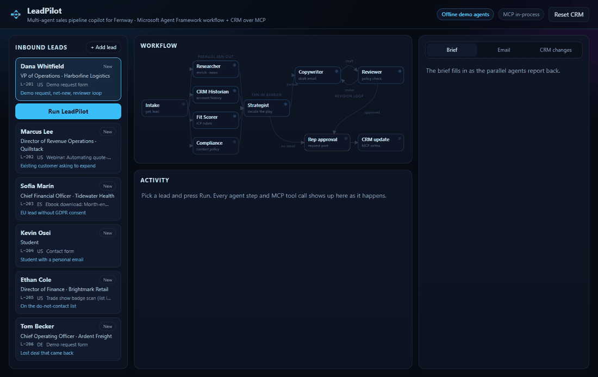
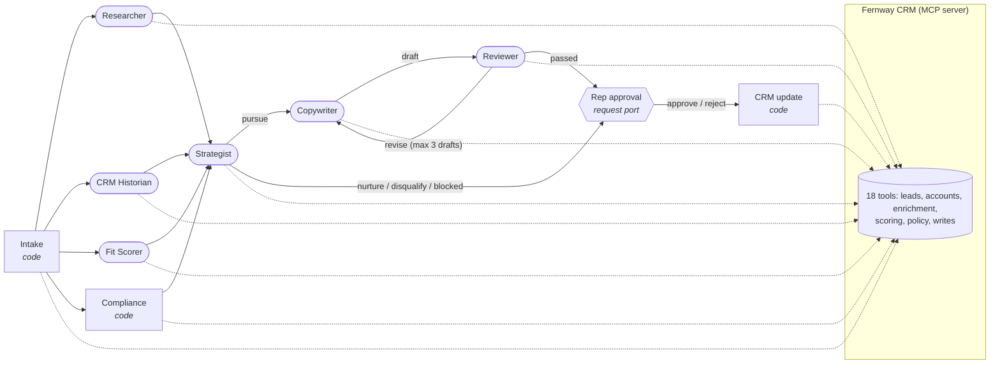
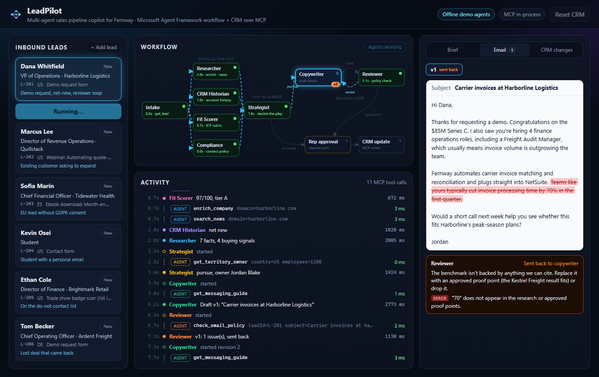
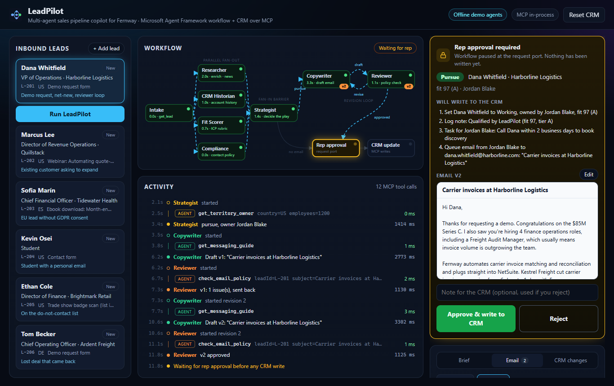
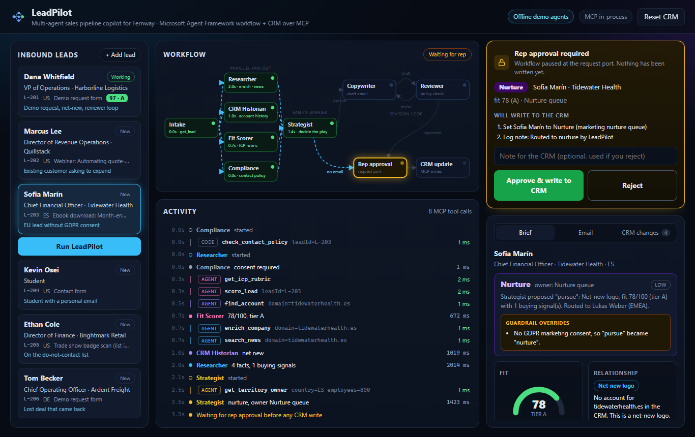
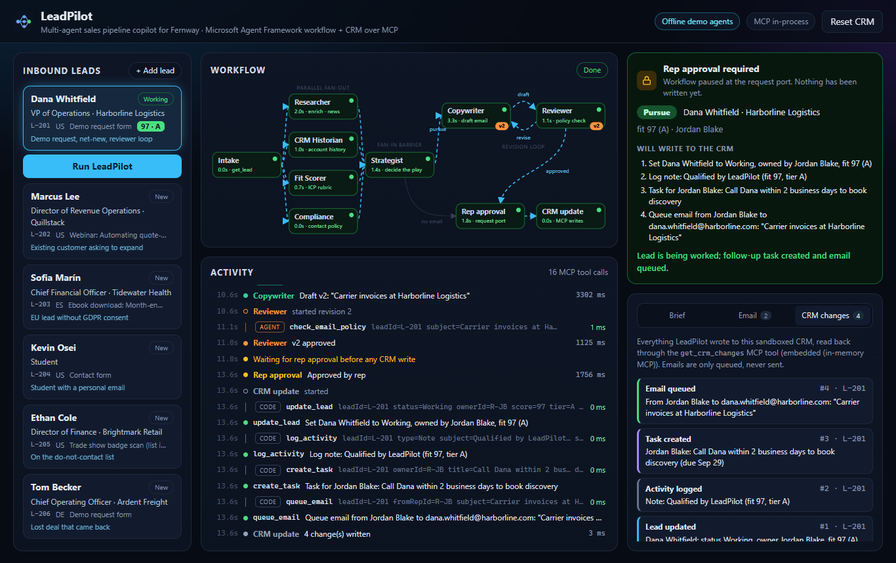

# LeadPilot: a multi-agent sales pipeline copilot

[](https://github.com/binodsapkota/leadpilot/actions/workflows/ci.yml)


LeadPilot qualifies inbound leads for **Fernway**, a fictional workflow-automation vendor. When a lead arrives, a team of
AI agents researches the company, checks CRM history, scores fit, and decides the play. For leads worth pursuing, a
copywriter drafts a personal first-touch email, and a reviewer can send it back for revision. A sales rep approves before
anything is written to the CRM.

It's a **graph workflow** built with [Microsoft Agent Framework](https://github.com/microsoft/agent-framework):

- **Parallel fan-out**: four specialist branches run at the same time.
- **Fan-in barrier**: the strategist waits for all four reports.
- **Revision loop**: the copywriter and reviewer iterate, capped at three drafts.
- **Human-in-the-loop**: a request port pauses the run until the rep decides.

The CRM is a separate **[Model Context Protocol](https://modelcontextprotocol.io) server**. Agents only reach CRM data
through MCP tools, and any other MCP client can connect to the same server.

It runs **fully offline out of the box**. Deterministic demo agents drive the real framework and the real MCP protocol,
and one environment variable switches the same workflow to a real LLM.



## What to look at

| If you care about... | Look at |
|---|---|
| Graph orchestration | [`LeadWorkflowFactory.cs`](src/LeadPilot.Core/Workflow/LeadWorkflowFactory.cs): fan-out edge, fan-in barrier, typed conditional edges forming a loop, request port |
| Agents in a workflow | [`Executors/`](src/LeadPilot.Core/Workflow/Executors): each node is an executor. Six wrap an agent, three are plain code |
| MCP | [`CrmTools.cs`](src/LeadPilot.Crm/Tools/CrmTools.cs) (18 tools with read-only and open-world hints), [`CrmConnection.cs`](src/LeadPilot.Core/Mcp/CrmConnection.cs) (in-process or Streamable HTTP client), [`LeadPilot.CrmServer`](src/LeadPilot.CrmServer/Program.cs) |
| Guardrails in code, not prompts | [`DecisionExecutors.cs`](src/LeadPilot.Core/Workflow/Executors/DecisionExecutors.cs) (strategist overrides, authoritative policy check), [`Policies.cs`](src/LeadPilot.Crm/Policy/Policies.cs) (scoring, contact policy, "every number must be sourced") |
| Tests | [`tests/`](tests/LeadPilot.Tests): every lead path, misbehaving-agent guardrail tests, MCP over both transports, the SSE API |
| Streaming UX | Live workflow graph, MCP tool-call timeline, streaming drafts with reviewer highlights ([`frontend/src`](frontend/src)) |

## The workflow



| Node | Kind | MCP tools | Output |
|---|---|---|---|
| Intake | code | `get_lead` | The lead, sent to all four branches |
| Researcher | agent | `enrich_company`, `search_news` | Sourced facts (F1, F2...) and buying signals |
| CRM Historian | agent | `find_account`, `get_account_history` | Net-new, existing customer, or former opportunity, plus the owner |
| Fit Scorer | agent | `get_icp_rubric`, `score_lead` | Score 0-100 and tier A-D, with a per-criterion breakdown |
| Compliance | code | `check_contact_policy` | Clear, consent required, or blocked |
| Strategist | agent | `get_territory_owner` | Pursue, nurture, disqualify or blocked, plus owner, angle and next steps |
| Copywriter | agent | `get_messaging_guide` | A draft email, streamed token by token |
| Reviewer | agent | `check_email_policy` | Pass, or a list of issues that sends the draft back |
| Rep approval | human | none | Approve (optionally with edits) or reject |
| CRM update | code | `update_lead`, `log_activity`, `create_task`, `queue_email` | Exactly the writes the rep saw |

Compliance, intake and CRM writes are deliberately plain code. Whether a lead may be contacted is a rule, not a
judgment call, and writes should never depend on a model deciding to make them.

## Guardrails live in code

Each agent's instructions describe the rules, but the workflow **enforces** them after the agent answers. The guardrail
tests swap in agents that misbehave on purpose and check that the result is still correct:

- **The score comes from the rubric, not the model.** The Fit Scorer's number is replaced by the `score_lead` result.
  If the agent never calls the tool, code calls it.
- **Contact policy beats the strategist.**
  - A blocked contact (do-not-contact list, competitor) forces the decision to `blocked`.
  - Missing GDPR consent turns `pursue` into `nurture`.
  - A tier D net-new lead is never pursued.
  - Every override is listed on the brief and the approval card.
- **Ownership rules.** Existing customers and former opportunities stay with their account owner. Net-new leads go to
  the territory owner.
- **The CRM historian can't invent accounts.** If `find_account` found nothing, the relationship is forced to net-new.
- **The reviewer can't wave a draft through.** `check_email_policy` is authoritative. It checks:
  - length, subject, banned phrases, personalization, and a call to action;
  - that **every number in the email appears in the research or an approved proof point**. That's how invented
    statistics are caught.
- **Nothing is written without approval.** The run parks at a request port, and the rep sees the exact list of CRM
  writes before approving.
- **The CRM checks again.** `queue_email` re-runs the contact and email policy server-side, so an edited email with a
  made-up number is refused even after approval.
- **Bounded loops and sandboxes.**
  - The revision loop stops after three drafts; the last one goes to the rep with its open issues attached.
  - Each browser workspace gets its own MCP session and CRM sandbox.
  - The API rate-limits runs per client.

## Demo leads

| Lead | Situation | What happens |
|---|---|---|
| **Dana Whitfield**, VP Ops, Harborline Logistics | Demo request; $85M Series C; hiring finance ops | Fit 97 (A), routed to the mid-market rep. Draft v1 claims a "70%" benchmark nobody can source, so the reviewer sends it back. v2 cites the Kestrel Freight proof point instead |
| **Marcus Lee**, Director RevOps, Quillstack | Existing customer asking about billing | Stays with the account owner. The email builds on the last QBR note and loops in the CSM |
| **Sofia Marín**, CFO, Tidewater Health (Spain) | Great fit, but no marketing consent | The strategist wants to pursue. The GDPR guardrail overrides it to nurture |
| **Kevin Osei**, student, gmail | Wants a free license | Tier D, disqualified |
| **Ethan Cole**, Director of Finance, Brightmark Retail | Unsubscribed in March | Blocked, marked do-not-contact |
| **Tom Becker**, COO, Ardent Freight (Germany) | Lost last year over a missing connector; now on NetSuite | Back to the original owner. The email leads with the NetSuite connector that closes the old gap |

You can also add your own lead from the UI (it goes into the CRM through the `add_inbound_lead` MCP tool) and run it.

> **About the demo agents.** They're deterministic stand-ins so the project runs without a key. Two behaviors are
> scripted on purpose so the guardrails have something to catch:
>
> - For net-new logistics leads, the copywriter's first draft includes an unsourced benchmark.
> - The strategist ignores GDPR consent.
>
> In live mode, a real model makes (or avoids) those mistakes on its own, and the same code checks apply.



<details>
<summary>More screenshots</summary>







</details>

## Run it

### Docker (one command)

```bash
docker compose up --build
```

Open http://localhost:8080. Compose runs three containers: the UI, the API, and the CRM as a standalone MCP server.
The API talks to the CRM over Streamable HTTP.

### Local development

Requires the .NET 10 SDK and Node 22+.

```bash
dotnet run --project src/LeadPilot.Api        # API on http://localhost:5080 (CRM MCP server runs in-process)
cd frontend && npm install && npm run dev     # UI on http://localhost:5173 (proxies /api)
```

To run the CRM as its own MCP server instead:

```bash
dotnet run --project src/LeadPilot.CrmServer  # MCP endpoint on http://localhost:5090/mcp
LeadPilot__CrmMode=http dotnet run --project src/LeadPilot.Api
```

```bash
dotnet test                                   # unit, workflow, guardrail, MCP and API tests
```

### Connect any MCP client to the CRM

The CRM server speaks standard MCP over Streamable HTTP, so it isn't tied to LeadPilot. Start it as shown above, then
point any MCP client at `http://localhost:5090/mcp`. For example:

```bash
npx @modelcontextprotocol/inspector           # choose "Streamable HTTP" and enter the URL
```

or, in VS Code, add it to `.vscode/mcp.json`:

```json
{ "servers": { "fernway-crm": { "type": "http", "url": "http://localhost:5090/mcp" } } }
```

Each MCP session gets its own sandboxed copy of the CRM, so experiments never leak between clients.

### Use a real model

Any OpenAI-compatible endpoint works, including Azure AI Foundry, Ollama and LM Studio.

```bash
cp .env.example .env        # then fill in OPENAI_API_KEY (and optionally OPENAI_MODEL / OPENAI_BASE_URL)
docker compose up --build
```

For local runs, set `LeadPilot__Mode=openai` and `LeadPilot__OpenAIApiKey=...` (or `OPENAI_API_KEY`).

In live mode:

- Each agent gets its instructions from [`AgentRoster.cs`](src/LeadPilot.Core/Agents/AgentRoster.cs).
- JSON-producing agents use structured output (a JSON schema generated from the C# record).
- The graph, MCP tools, guardrails and approval flow are identical.

## API

| Method | Path | Notes |
|---|---|---|
| `GET` | `/api/health` | Mode, model and CRM transport |
| `GET` | `/api/agents` | The six agents and their MCP tools |
| `GET` | `/api/graph` | Workflow nodes and edges |
| `POST` | `/api/workspaces` | New workspace (MCP session + CRM sandbox) |
| `GET` | `/api/workspaces/{id}` | Leads, CRM changes, pending approval |
| `POST` | `/api/workspaces/{id}/leads` | Add an inbound lead |
| `POST` | `/api/workspaces/{id}/runs` | `{ "leadId": "L-201" }` → SSE stream (event types listed below) |
| `POST` | `/api/workspaces/{id}/runs/{runId}/decision` | `{ "approved": true, "subject"?, "body"?, "note"? }` → resumes the paused run as an SSE stream |

The run stream emits these events:

- `run_started`
- `node_started`, `node_completed`
- `tool_call`, `tool_result`
- `token`
- `report`
- `approval_required`
- `crm_write`
- `run_completed`
- `error`

## Project layout

```
src/LeadPilot.Crm          CRM domain, seed data, policies, and the MCP tool class
src/LeadPilot.CrmServer    standalone MCP server (Streamable HTTP)
src/LeadPilot.Core         workflow graph, executors, agents, MCP client, demo agents, runtime
src/LeadPilot.Api          minimal API + server-sent events
tests/LeadPilot.Tests      xUnit: policies, MCP (both transports), workflow paths, guardrails, HTTP API
frontend/                  React 19 + Vite + TypeScript UI
```

## Design notes

- **Why a graph and not handoffs or a supervisor?** Lead qualification is a pipeline with a known shape. Research,
  history, scoring and compliance are independent, so they run in parallel. The decision needs all four. The draft needs
  critique. A graph makes that structure explicit and testable, and a barrier edge gives the fan-in for free.
  Conversations where one agent owns the floor fit handoffs better; see
  [SignalDesk](https://github.com/binodsapkota/signaldesk) for that pattern.
- **Why MCP for the CRM?**
  - It puts a real process boundary between agents and system-of-record data.
  - Tool contracts, including read-only and open-world hints, live in one place.
  - The same server can be used by any MCP client.
  - In-process mode still speaks the real protocol over in-memory pipes, so tests cover the actual wire format.
- **Agents and code share one trace.** Code-driven MCP calls (intake, compliance, CRM writes, guardrail fallbacks) emit
  the same `tool_call`/`tool_result` events as agent calls, labeled `code` or `agent` in the UI.
- **Offline demo agents use the real framework.** Each demo agent is an `IChatClient` that returns tool calls, then
  text. Function invocation, MCP transport, the workflow runtime and the request port are all used as-is.
- **Honest limits.**
  - Workspaces live in memory.
  - The CRM is a seeded sandbox, and emails are only queued, never sent.
  - There's no authentication.
  - This is a showcase of orchestration and guardrails, not a production sales platform.

[`docs/architecture.md`](docs/architecture.md) walks through a full run event by event.

## License

[MIT](LICENSE) © Binod Sapkota
